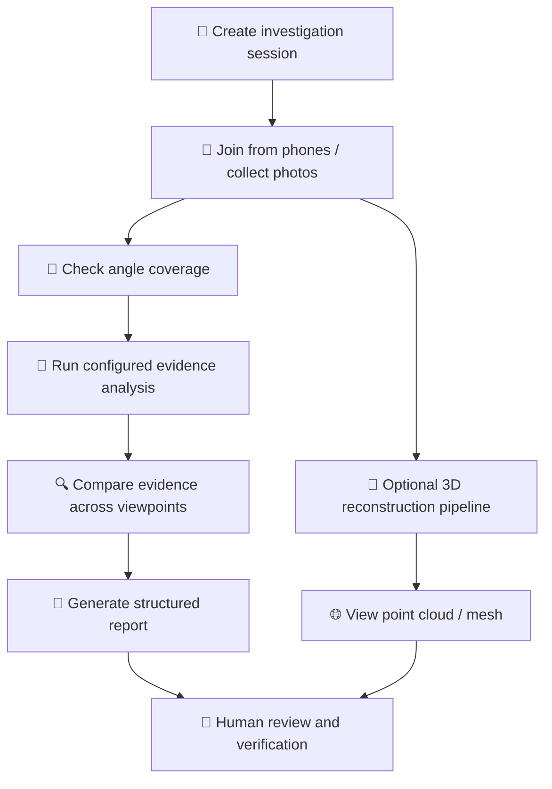

<div align="center">

# 🚦 MANZAR
### AI-Powered Traffic Accident Evidence Analysis & 3D Reconstruction

**Capture the scene. Corroborate the evidence. Build a clearer picture.**

MANZAR is a prototype platform for traffic-accident investigation that brings multi-device photo collection, AI-assisted evidence detection, viewpoint coverage checks, evidence cross-checking, and structured report generation into one workflow.

[✨ Features](#-key-features) · [🧠 How It Works](#-how-it-works) · [⚙️ Setup](#️-getting-started) · [🔌 API](#-api-overview) · [🗺️ Roadmap](#️-roadmap)

</div>

---

## 📌 About the Project

Accident scenes can change quickly, and evidence captured from only one viewpoint may leave important context out. **MANZAR** is designed to help investigators organize scene photos from multiple devices, inspect possible evidence, identify missing viewpoints, and prepare a reviewable incident report.

The backend is built with **FastAPI** and the user interface is served as a single-page HTML application. AI and 3D reconstruction components are integrated as a prototype workflow; results should be reviewed by a qualified human and must not be treated as an autonomous determination of fault or as court-validated evidence.

> 🎯 **Project goal:** support a more structured, multi-angle accident documentation workflow—not replace investigators, forensic experts, or official procedures.

## ✨ Key Features

| Feature | What it does |
|---|---|
| 📱 **Multi-device evidence capture** | Create an investigation session and collect photos from different phones/devices. |
| 🔳 **QR-assisted joining** | Session and QR-related routes help devices join the collection workflow. |
| 🧭 **Angle coverage checks** | Tracks front, rear, left, and right viewpoints and identifies missing angles. |
| 🤖 **AI-assisted evidence detection** | Includes a YOLO-based detection service and a configurable vision-language model service. |
| 🔍 **Cross-angle corroboration** | Compares observations across device/angle sources to highlight evidence seen from multiple viewpoints. |
| 🧾 **Structured incident reports** | Builds a report containing case details, evidence findings, coverage, timeline, and analysis fields. |
| 🔐 **Photo integrity metadata** | Computes a SHA-256-derived hash for uploaded photos to support integrity checking. A hash alone does not prove authenticity or custody. |
| 💬 **Ask MANZAR assistant** | Provides a session-grounded conversational interface for questions about the collected evidence. |
| 🧊 **3D reconstruction pipeline** | Includes a COLMAP-based pipeline for sparse/dense reconstruction and point-cloud/mesh serving, subject to compatible tools and input quality. |
| ⚡ **Live updates** | WebSocket events communicate session and processing updates to connected clients. |
| 📄 **PDF report generation** | Includes a PDF report service when its optional dependencies are installed. |

## 🧠 Evidence Classes

The project is configured around four accident-scene evidence categories:

- 🚗 **Vehicle damage** — visible damage to a vehicle.
- 🛞 **Skid marks** — possible braking or tire marks on the road.
- 🧩 **Debris field** — scattered vehicle or road debris.
- 🎯 **Point of impact** — a possible collision/contact area.

Detection availability and performance depend on the installed model, configured provider, image quality, and environment. The repository does **not** establish a universal accuracy percentage; validate the model against a documented test set before making performance claims.

## 🔄 How It Works



1. **Create a session** and record the relevant case information.
2. **Collect photographs** from multiple devices and label their viewpoints when possible.
3. **Check coverage** to see whether front, rear, left, and right angles have been represented.
4. **Analyze images** using the configured detection components.
5. **Review corroboration** across the available viewpoints and inspect uncertain findings.
6. **Generate a report** for investigator review. 3D reconstruction can be attempted when the required tools and suitable overlapping images are available.

## 🧰 Technology Stack

- **Language:** Python
- **API backend:** FastAPI, Uvicorn
- **Request validation / uploads:** Pydantic, `python-multipart`
- **Computer vision:** Ultralytics YOLO service (model weights included in the repository)
- **Vision-language analysis:** configurable Gemini / OpenRouter integration in the vision service
- **3D reconstruction:** COLMAP pipeline; optional OpenMVS / Open3D-related workflow components
- **Frontend:** HTML, CSS, and JavaScript served from `static/MANZAR.html`
- **Real-time communication:** WebSockets
- **Reports:** structured report generation and optional PDF rendering
- **Optional public demo tunnel:** pyngrok

## 📁 Repository Structure

```text
manzar-ai-master/
├── app/
│   ├── main.py                    # FastAPI application and static frontend serving
│   ├── store.py                   # In-memory session state and connection manager
│   ├── tunnel.py                  # Optional ngrok tunnel support
│   ├── routes/
│   │   ├── session.py             # Session creation, listing and joining helpers
│   │   ├── upload.py              # Photo uploads and analysis workflow
│   │   ├── reconstruction.py      # Reconstruction trigger/status workflow
│   │   ├── chat.py                # Ask MANZAR API
│   │   ├── assets.py               # Photos, point cloud and mesh endpoints
│   │   └── ws.py                   # WebSocket updates
│   └── services/
│       ├── detection.py            # YOLO evidence detection
│       ├── gemini_detect.py        # Vision-language evidence analysis
│       ├── coverage_check.py       # Required-angle coverage checks
│       ├── cross_angle.py          # Cross-view evidence comparison
│       ├── pipeline.py              # 3D reconstruction orchestration
│       ├── report_gen.py            # Structured report creation
│       └── report_pdf.py            # PDF rendering
├── models/
│   └── FINAL_best_model.pt         # Included trained model weights
├── static/
│   └── MANZAR.html                 # Web application interface
├── notebooks/                      # (Notebooks are at repository root in this version)
├── manaza-finetune.ipynb           # Model fine-tuning notebook
├── manzar-self-contained-pipeline.ipynb
├── test_demo.py                    # Demo/test script
├── DEMO_SCRIPT.md                  # Demo walkthrough
├── requirements.txt                # Core Python dependencies
├── .env.example                    # Environment variable template
└── colmap-wrapper.sh                # COLMAP wrapper (platform-specific)
```

> Note: the ZIP also contains a bundled `colmap-bin/` directory with macOS application libraries. That bundle is platform-specific and may not run on Windows or Linux. The reconstruction pipeline can use a separately installed COLMAP binary via `COLMAP_BIN`.

## ⚙️ Getting Started

### 1. Prerequisites

- Python **3.10+** recommended; use a clean virtual environment.
- Git (for cloning).
- A supported browser.
- Optional: an API key for the configured vision-language provider.
- Optional for 3D reconstruction: a compatible COLMAP installation and any additional reconstruction tools required by the selected pipeline.

> 📝 The core server can start without configuring every optional AI/reconstruction integration, but some features may be unavailable until their dependencies and settings are configured.

### 2. Clone the repository

```bash
git clone https://github.com/YOUR-USERNAME/manzar-ai.git
cd manzar-ai
```

Replace the URL with your actual GitHub repository URL.

### 3. Create and activate a virtual environment

**Windows PowerShell**
```powershell
py -m venv .venv
.\.venv\Scripts\Activate.ps1
```

If PowerShell blocks activation, you can use Command Prompt instead:
```bat
.venv\Scripts\activate.bat
```

**macOS / Linux**
```bash
python3 -m venv .venv
source .venv/bin/activate
```

### 4. Install dependencies

```bash
python -m pip install --upgrade pip
pip install -r requirements.txt
```

Some optional services import additional packages only when used (for example, the YOLO service requires `ultralytics`, and PDF rendering requires `xhtml2pdf`). If a feature reports a missing dependency, install the package required by that feature in your environment.

For YOLO inference, a typical optional install is:
```bash
pip install ultralytics
```

For PDF rendering, if needed:
```bash
pip install xhtml2pdf
```

### 5. Configure environment variables

**Windows PowerShell**
```powershell
Copy-Item .env.example .env
```

**macOS / Linux**
```bash
cp .env.example .env
```

Open `.env` and set only the values you need. Important settings include:

| Variable | Purpose |
|---|---|
| `PORT` | Server port; defaults to `8000`. |
| `FRONTEND_URL` | Base URL used by session/QR workflows. |
| `LLM_PROVIDER` | Chat provider setting; supported choices described in `.env.example` (`stub`, `qwen`, `gemini`). |
| `LLM_API_KEY` | API key(s) for the configured language/vision provider. Keep secrets private. |
| `LLM_MODEL` | Model name for the configured provider. |
| `VISION_PROVIDER` | Vision service provider selector (`gemini` or `openrouter` in the vision service). |
| `OPENROUTER_API_KEY` | Optional OpenRouter key when using OpenRouter. |
| `OPENROUTER_MODEL` | Optional OpenRouter model identifier. |
| `COMPUTE_BACKEND` | Reconstruction backend setting: `local`, `kaggle`, `colab`, or `ecs`. |
| `COLMAP_BIN` | Path to a compatible COLMAP executable or wrapper. |
| `OPENMVS_BIN` | Optional OpenMVS binary directory. |
| `USE_TUNNEL` | Set to `true` only when you intentionally want to enable the ngrok tunnel. |
| `NGROK_AUTH_TOKEN` | ngrok authentication token, if a tunnel is enabled. |

Never commit `.env`, API keys, access tokens, private case data, or real accident-scene images.

### 6. Run the backend

From the repository root, with the virtual environment active:

```bash
python -m uvicorn app.main:app --reload --host 0.0.0.0 --port 8000
```

Then open:

- **MANZAR web app:** http://localhost:8000/MANZAR.html
- **Health endpoint:** http://localhost:8000/
- **Interactive API docs:** http://localhost:8000/docs
- **OpenAPI schema:** http://localhost:8000/openapi.json

To use from another phone on the same Wi-Fi, open the host computer's LAN IP and port `8000` on the phone, and ensure the firewall allows the connection. Do not expose the service publicly unless it has been secured for that environment.

## 🔌 API Overview

The API is exposed by FastAPI. The exact request fields and response schemas can be inspected at `/docs` while the server is running.

| Area | Route / pattern | Purpose |
|---|---|---|
| 🩺 Health | `GET /` | Check whether the backend is running. |
| 🗂️ Sessions | `GET /sessions` | List available in-memory sessions. |
| 📸 Upload | `POST /session/{session_id}/upload` | Upload a photo with optional angle/device/GPS metadata. |
| 🧊 Reconstruction | `POST /session/{session_id}/reconstruct` | Queue reconstruction for a session with sufficient relevant photos. |
| 💬 Assistant | `POST /session/{session_id}/chat` | Ask a question about the current session. |
| 🖼️ Photos | `GET /session/{session_id}/photos` | Retrieve photo metadata. |
| 🧱 Mesh | `GET /session/{session_id}/mesh` | Download the available reconstructed mesh. |
| ☁️ Point cloud | `GET /session/{session_id}/pointcloud` | Download the available point cloud. |
| 🔌 WebSocket | `WS /ws/{session_id}` | Receive live session and processing events. |
| 🌐 Tunnel | `GET /tunnel/status` | Inspect optional tunnel status. |

Additional session and report endpoints are documented in the running API docs. Some endpoints require a valid session ID or a completed processing stage.

## 🧪 Dataset & Model

- **Dataset:** [MANZAR Final Dataset on Kaggle](https://www.kaggle.com/datasets/abdullahmirza2004/manzar-final-dataset)
- **Model weights:** `models/FINAL_best_model.pt`
- **Training notebooks:** `manaza-finetune.ipynb` and `manzar-self-contained-pipeline.ipynb`

For reproducible evaluation, document the dataset split, class-wise precision/recall, mAP (if applicable), confidence thresholds, hardware, and test procedure. Do not describe model output as verified forensic evidence without independent expert validation.

## 🎬 Demo Guide

A step-by-step demo outline is available in [`DEMO_SCRIPT.md`](DEMO_SCRIPT.md).

Suggested walkthrough:
1. Start the API and open the MANZAR web interface.
2. Create a sample investigation session.
3. Join from a second device or browser and upload sample photos.
4. Inspect angle coverage and AI findings.
5. Review cross-angle corroboration and the generated report.
6. If reconstruction dependencies are configured, demonstrate the point cloud or mesh viewer.

Use synthetic/demo material or images you are authorized to share. Do not publish identifiable people, license plates, precise locations, or sensitive case data without permission.

## 🛡️ Security, Privacy & Responsible Use

- 🔑 Store secrets in `.env`; `.env.example` should contain placeholders only.
- 🚫 Do not commit credentials, tokens, uploaded evidence, or sensitive session data.
- 🌐 The current application enables permissive CORS (`*`) and stores session data in process memory. This is suitable only for controlled development/demo environments—not production deployment.
- 🧾 SHA-256 hashes can help detect changes to a file after hashing, but they do not by themselves prove who captured the image, when it was captured, or that the original evidence is authentic.
- 👤 AI-generated findings can be incorrect or incomplete. Have a qualified investigator verify detections, measurements, and conclusions.
- ⚖️ MANZAR is a research/prototype tool, not a substitute for official forensic procedures, legal advice, or a certified accident reconstruction expert.

## 🗺️ Roadmap

- [ ] Harden authentication, authorization, and session access controls.
- [ ] Replace in-memory session storage with persistent, access-controlled storage.
- [ ] Configure and test production-safe CORS and upload validation.
- [ ] Add automated tests and reproducible evaluation metrics.
- [ ] Validate cross-angle corroboration against labeled multi-view examples.
- [ ] Improve portability and documentation for COLMAP/OpenMVS/Open3D dependencies.
- [ ] Add deployment configuration and operational logging suitable for secure environments.

## 🤝 Contributing

Contributions, issue reports, and suggestions are welcome.

1. Fork the repository.
2. Create a feature branch: `git checkout -b feature/your-change`.
3. Make and test your changes.
4. Commit with a clear message.
5. Open a pull request describing the change and how it was tested.

## 📜 License

No license file was identified in the provided project archive. Unless a license is added by the maintainers, reuse and redistribution permissions are not explicitly granted. Add a `LICENSE` file before inviting external reuse.

---

<div align="center">

### 🚦 MANZAR
**Better scene documentation through multi-angle evidence and AI-assisted analysis.**

*Built as an AI / computer-vision prototype for traffic accident investigation support.*

</div>
